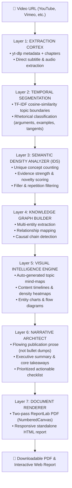

# 🎬 VidMash — Watch Less. Know More.

> **Transform hours of internet video into publication-grade intelligence documents in minutes. 100% Zero-Loss Synthesis with AI-generated diagrams, graphs, mind-maps, and checklists.**

---

## ⚡ Why VidMash?

Long-form videos (keynotes, lectures, podcasts, technical deep-dives) contain immense value, but watching them takes hours. Standard summarizers produce shallow 5-bullet summaries that lose all the nuanced technical details, statistics, and causal relationships.

**VidMash solves this with a unique 7-layer cognitive synthesis pipeline.**  
It treats video transcription not as text to compress, but as an information graph to rebuild. The result is a publication-quality PDF and interactive HTML report with **0% need to watch the original video**.

---

## 🧠 The 7-Layer Cortex Engine



### 🔬 The Semantic Density Algorithm (Secret Sauce)

VidMash evaluates every semantic segment using a multi-signal Information Density Score (**IDS**):

$$\text{IDS} = \frac{\text{unique\_concepts} \times \text{evidence\_strength} \times \text{novelty}}{\text{word\_count} \times \text{repetition\_factor}} \times \text{linguistic\_boost}$$

- **Unique Concepts:** Distinct technical and subject-matter terms with TF-IDF weights above threshold.
- **Evidence Strength:** Detection of citations, studies, percentages, dollar figures, and concrete entities.
- **Novelty:** Cosine distance of the segment against prior cumulative topics (penalizing redundant content).
- **Repetition Factor:** Measures semantic overlap with earlier segments.
- **Linguistic Boost:** Amplification for critical rhetorical markers (*"crucial"*, *"fundamental"*, *"in conclusion"*) and dampening for conversational filler (*"um"*, *"you know"*, *"basically"*).

Segments scoring above the dynamic threshold are tagged **High-Value Segments (HVS)** for prioritized deep-dive synthesis and entity relation extraction.

---

## 📊 Visual Intelligence (Auto-Generated)

VidMash automatically detects the structural characteristics of the video and renders high-resolution figures:

1. 🗺️ **Topic Mind Map:** Radial concept hierarchy connecting central themes to leaf insights.
2. ⏱️ **Content Timeline:** Color-coded chronological roadmap of topics and rhetorical shifts.
3. 🌡️ **Information Density Heatmap:** Visual representation of where the deepest insights occur.
4. 📊 **Entity Mention Bar Chart:** Frequency distribution of individuals, organizations, and technologies.
5. 🔗 **Entity Relationship Graph:** Spring-layout network visualization of interconnected concepts.
6. 🔀 **Causal Flow Diagram:** Step-by-step flowchart of causal chains and chronological processes.

---

## 🚀 Quick Start

### 1. Prerequisites
- Python 3.11+
- [uv](https://docs.astral.sh/uv/) (recommended) or standard `pip`

### 2. Installation

Clone the repository and install dependencies:

```bash
git clone https://github.com/wealthninja77-dotcom/vidmash.git
cd vidmash

# Using uv (fastest)
uv pip install -r requirements.txt

# Or using standard pip
pip install -r requirements.txt
```

### 3. Environment Configuration

Copy `.env.example` to `.env` and supply your Google Gemini API key:

```bash
cp .env.example .env
```

Edit `.env`:
```ini
GEMINI_API_KEY=your_gemini_api_key_here
OUTPUT_DIR=./output
MAX_VIDEO_DURATION=14400
HOST=0.0.0.0
PORT=8000
```

> **Note:** Even without an API key, VidMash will still run Layers 1, 2, 3, 5, and 7 using local NLP, TF-IDF, and heuristic synthesis! Supplying a Gemini API key unlocks the full potential of Layers 4 and 6 (deep entity relationship discovery and narrative prose composition).

### 4. Running the Application

```bash
python run.py
```

The application will start at `http://localhost:8000`.

---

## 🖥️ UI & REST API

### Web Interface
- **Landing Page (`/`):** Paste any video link with instant validation.
- **Real-Time Monitor (`/processing/{job_id}`):** Live progress indicators tracking all 7 layers of the Cortex engine.
- **Interactive Report (`/report/{job_id}`):** Full-page web report with responsive navigation, sticky table of contents, and interactive checklists.
- **PDF Download (`/api/download/pdf/{job_id}`):** Two-pass print-perfect PDF.

### REST Endpoints

| Method | Endpoint | Description |
|---|---|---|
| `POST` | `/api/process` | Submit a video URL (`{"url": "..."}`) and receive `job_id` |
| `GET` | `/api/status/{job_id}` | Check real-time progress percentage and stage |
| `GET` | `/api/download/pdf/{job_id}` | Download generated PDF report |
| `GET` | `/api/download/html/{job_id}` | Download generated standalone HTML report |

---

## 🏗️ Project Architecture

```
VIDMASH/
├── app/
│   ├── config.py                  # Pydantic BaseSettings & environment loader
│   ├── main.py                    # FastAPI routes & async task manager
│   ├── core/                      # The 7-Layer Cortex Engine
│   │   ├── layer1_extraction.py   # yt-dlp metadata + transcript extraction
│   │   ├── layer2_segmentation.py # TF-IDF boundary detector & rhetorical classifier
│   │   ├── layer3_density.py      # Multi-signal Semantic Density Algorithm (IDS)
│   │   ├── layer4_knowledge.py    # Entity, relationship, and causal graph builder
│   │   ├── layer5_visuals.py      # Matplotlib publication chart generators
│   │   ├── layer6_narrative.py    # Gemini-powered flowing prose architect
│   │   ├── layer7_renderer.py     # ReportLab PDF + HTML document compiler
│   │   └── pipeline.py            # Async orchestrator connecting all 7 layers
│   ├── models/
│   │   └── schemas.py             # Pydantic domain models
│   ├── services/
│   │   ├── ai_service.py          # Gemini 2.0 Flash async wrapper
│   │   └── transcript_service.py  # youtube_transcript_api + fallback handler
│   ├── static/                    # Brand assets, CSS, and client-side JS
│   └── templates/                 # Jinja2 templates (index, processing, report)
├── output/                        # Default folder for generated artefacts
├── requirements.txt               # Pinned dependencies
├── run.py                         # Application runner
└── README.md
```

---

## 🛡️ License

MIT License. Built with passion for high-velocity learning and zero-loss knowledge extraction.
